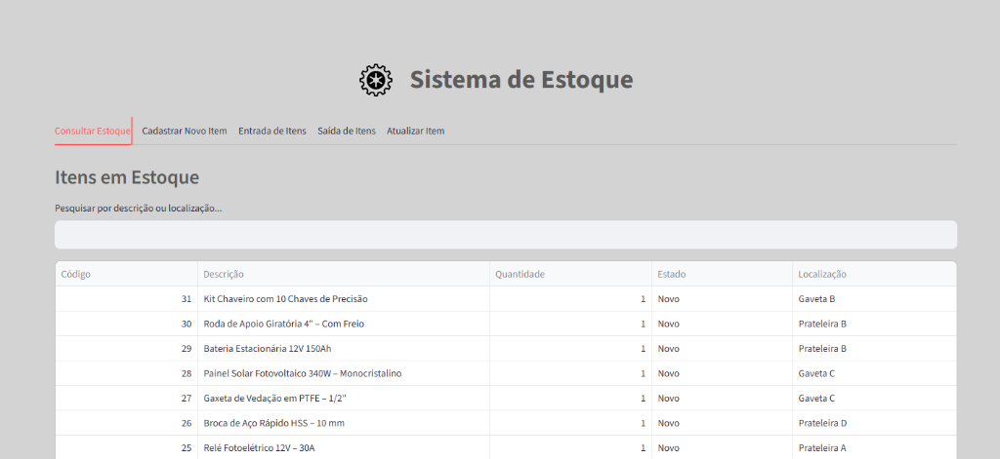
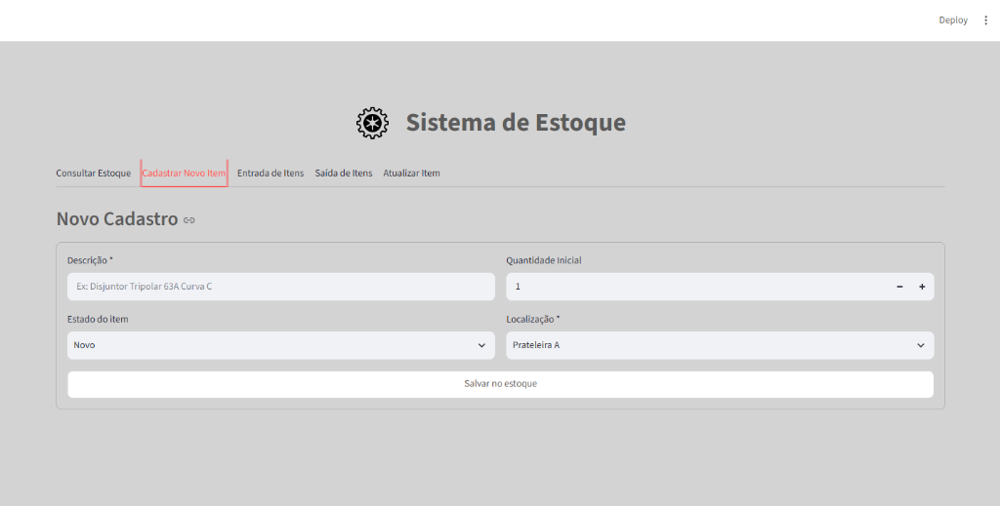
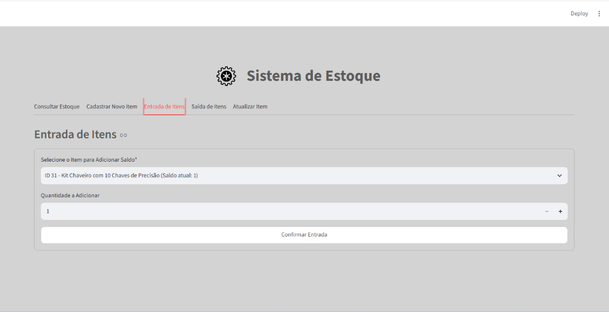
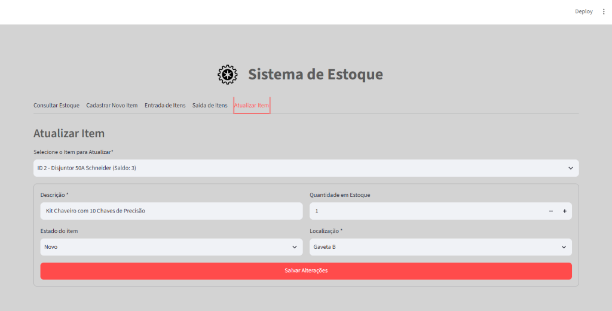

# 📦 Sistema de Gestão de Estoque

Aplicação desktop e web para gerenciamento e controle de estoque de materiais e equipamentos, construída com **Streamlit**, **Pandas** e **SQLite**.

---

## 📸 Telas do Sistema

### 1. Consultar Estoque
Visualização tabular interativa de todos os materiais cadastrados no sistema.
- **Busca em tempo real:** Filtre instantaneamente por descrição ou localização física.
- **Visão consolidada:** Informações sobre código (ID), quantidade, estado de conservação e localização física.



---

### 2. Cadastrar Novo Item
Formulário para inclusão de novos materiais e ferramentas no catálogo do estoque.
- **Campos estruturados:** Descrição detalhada do material e quantidade inicial.
- **Classificação:** Estado de conservação (*Novo*, *Usado*, *Recondicionado*, *Danificado*) e localização física (*Prateleiras*, *Armários* e *Gavetas*).



---

### 3. Entrada de Itens
Registro de reposições e recebimento de mercadorias para itens existentes.
- **Saldo em tempo real:** Mostra o saldo atual ao selecionar o produto.
- **Incremento seguro:** Adiciona a nova quantidade ao estoque de forma direta.



---

### 4. Atualizar Item
Interface para edição e manutenção de informações de itens já cadastrados.
- **Preenchimento automático:** Carrega automaticamente todos os dados atuais do item selecionado.
- **Edição completa:** Permite corrigir descrição, ajustar quantidade, atualizar estado ou trocar a localização do item.



---

## 🚀 Funcionalidades

- **Consultar Estoque:** Busca dinâmica por descrição ou localização, com ordenação e paginação interativa.
- **Cadastrar Novo Item:** Inclusão rápida de novos materiais com categorização e localização.
- **Entrada de Itens:** Adição de saldo com indicação visual do estoque atual.
- **Saída de Itens (Baixa):** Retirada de itens com validação contra estoque zerado e saldo negativo.
- **Atualização de Cadastro:** Alteração de dados cadastrais de materiais existentes.
- **Gerenciamento / Exclusão:** Remoção permanente com caixa de confirmação de segurança.

---

## 🛠️ Tecnologias Utilizadas

- **Python 3.10+**
- **Streamlit** (Interface gráfica interativa)
- **Pandas** (Tratamento e exibição de dados)
- **SQLite3** (Banco de dados relacional local embutido)
- **PyInstaller** (Compilação para executável `.exe`)

---

## 💻 Como Executar o Projeto

### 1. Clonar o repositório
```bash
git clone https://github.com/SEU_USUARIO/NOME_DO_REPOSITORIO.git
cd NOME_DO_REPOSITORIO
```

### 2. Criar e ativar o ambiente virtual (Recomendado)
```bash
# Windows
python -m venv .venv
.venv\Scripts\activate
```

### 3. Instalar as dependências
```bash
pip install -r requirements.txt
```

### 4. Executar a aplicação
```bash
streamlit run app.py
```
ou pelo inicializador com abertura automática de navegador:
```bash
python run.py
```

---

## ⚙️ Compilação para Executável (.exe)

O projeto possui suporte à geração de executável standalone via PyInstaller:
```cmd
compilar.bat
```
O executável final será gerado dentro da pasta `dist/GestaoManutencao/GestaoManutencao.exe`.
